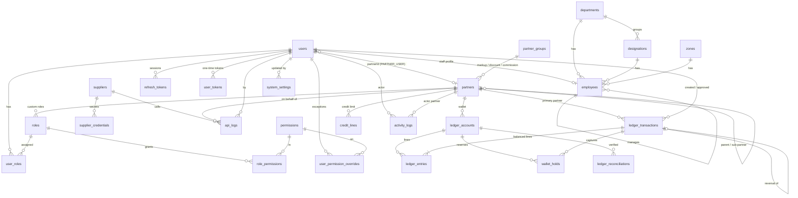
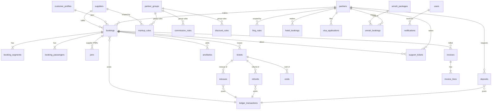
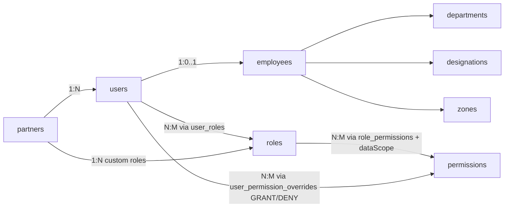

# Al-Qadr OTA — Step 1: Architecture & Database Design

Status: **v1 — PARTLY SUPERSEDED by `STEP1_REVISED.md`.** Where the two differ (hierarchy, credit, naming, env vars/cookies, 2FA, invoice numbering, ledger/hold/idempotency details, `schema.prisma` column names), `STEP1_REVISED.md` and the current `schema.prisma` win. No implementation code yet.

Contents
1. Monorepo architecture
2. Prisma schema (summary + table-by-table rationale)
3. ERD (Mermaid)
4. API endpoints (Phase 1)
5. Authentication architecture
6. RBAC & permission architecture
7. User / Employee / Role / Permission relationships
8. Activity / audit log
9. Partner & Supplier foundation
10. Business ID strategy
11. Wallet / ledger architecture
12. API response & error standard
13. Environment variables
14. Security considerations
15. Migration & seed strategy
16. Future-extension map (Phases 2–10)
17. Decisions I need you to confirm

---

## 1. Monorepo architecture

```
al-qadr-ota/
├─ pnpm-workspace.yaml            # packages: frontend, backend, shared
├─ package.json                   # root scripts: dev, build, lint, typecheck, test
├─ .nvmrc / .editorconfig / .gitignore / .prettierrc
├─ docker-compose.yml             # postgres:16, redis:7, mailpit (dev mail), adminer (optional)
├─ .github/workflows/ci.yml       # install, lint, typecheck, prisma validate, migrate, test
├─ docs/                          # ARCHITECTURE, ERD, API, RUNBOOK, ADRs (decision records)
│
├─ shared/                        # @alqadr/shared — framework-free TypeScript
│  └─ src/
│     ├─ permissions.ts           # SINGLE SOURCE OF TRUTH for permission codes + default role matrix
│     ├─ enums.ts                 # mirrors of Prisma enums (parity test fails CI if they drift)
│     ├─ schemas/                 # Zod schemas = request/response contracts used by BOTH apps
│     ├─ api-types.ts             # ApiSuccess<T>, ApiError, Paginated<T>
│     └─ money.ts, business-id.ts # pure helpers (format/validate, decimal-safe money)
│
├─ backend/                       # @alqadr/backend — NestJS
│  ├─ prisma/ schema.prisma, migrations/, seed/{core.ts,dev.ts}
│  └─ src/
│     ├─ main.ts, app.module.ts
│     ├─ config/                  # typed env loader, validated with Zod at boot (fail fast)
│     ├─ common/                  # guards, decorators, filters, interceptors, pipes, request-id
│     ├─ infra/                   # prisma/, redis/, queue/ (BullMQ), crypto/, mailer/, storage/
│     └─ modules/                 # one folder per domain, same internal layout:
│        ├─ auth/ users/ employees/ roles/ permissions/      (Phase 1 — implemented)
│        ├─ partners/ sub-partners/ suppliers/ ledger/       (Phase 1 shells / foundation)
│        ├─ activity-log/ api-logs/ configuration/           (Phase 1)
│        └─ supplier-integrations/ flights/ search/ pricing/ markup/ bookings/ pnr/ tickets/
│           refund/ reissue/ void/ ancillary/ wallet/ deposits/ credit/ invoices/ hotels/
│           visa/ umrah/ reports/ notifications/ support/      (later phases — empty today)
│
├─ frontend/                      # @alqadr/frontend — Next.js App Router
│  └─ src/
│     ├─ app/(public)/            # B2C site
│     ├─ app/(b2b)/               # partner portal
│     ├─ app/(admin)/             # admin panel
│     ├─ components/ui/           # shadcn/ui
│     ├─ lib/api/                 # typed client; the ONLY place that talks to the backend
│     └─ lib/auth/                # token handling, permission hooks (UI hints only)
```

**Rules that keep it modular**
- A module owns its tables. Other modules call its exported **service**, never its Prisma models. Example: only `LedgerService` writes `ledger_*` tables.
- Layering inside a module: `controller → service → repository (Prisma)`. Controllers contain no business logic.
- Dependency direction: `common`/`infra` ← `modules`. Modules depend on each other only through exported services (enforced with `eslint-plugin-boundaries`).
- `shared` has no Nest/React/Prisma imports. The frontend never imports the Prisma client.
- Supplier code lives behind `SupplierAdapter` (Phase 3). The frontend can never reach a supplier (it only knows the OTA API).
- Deploy targets are independent: `frontend` → Vercel; `backend` → container (AWS/Railway/Render/VPS); Postgres and Redis are external services configured only via env.

## 2. Prisma schema — what was designed and why

Full schema: `backend/prisma/schema.prisma`. Design principles:

1. **UUID PK everywhere; business IDs are separate columns** (section 10).
2. **No secrets or money in the wrong place.** Credentials are in their own encrypted table; wallet balance is derived from a ledger.
3. **Additive evolution.** Later phases add tables with FKs to these tables. Polymorphic references use `(referenceType, referenceId, referenceNo)` so new business objects can post to the ledger without changing it.
4. **Constraints in the database**, not only in code: FKs with explicit `onDelete`, CHECK constraints, partial unique indexes and triggers in raw-SQL migrations (marked `[RAW SQL]` in the schema).
5. Money = `Decimal(18,2)`, timestamps = `timestamptz` UTC, soft-delete only where legally needed (`users.deletedAt`); financial rows are never deleted.

### Table-by-table rationale

| Table | Why it exists | How it connects to future modules |
|---|---|---|
| `users` | One login identity for staff, partner users and customers. One auth pipeline, one audit trail. `userType` + nullable `partnerId` (CHECK-enforced) separates them. `permissionVersion` invalidates cached permissions instantly. | `createdById/requestedById` on bookings, deposits, refunds, support tickets; B2C `customer_profiles.userId` (Phase 9). |
| `employees` | HR/org data for staff only (code, department, designation, zone, manager). Keeps `users` lean. | `bookings.assignedEmployeeId`, support assignment, zone-scoped reports. |
| `departments`, `designations`, `zones` | Spec's Department / Designation / Zone lists. Zone drives `ZONE` data scope. | `partners.zoneId` (additive column, Phase 2), zone sales report. |
| `roles` | Named permission bundles. `scope` = PLATFORM / PARTNER / CUSTOMER. `partnerId` set = custom role owned by a partner (parent controls sub-partner permissions). | Phase 2 sub-partner permission management uses these directly. |
| `permissions` | Catalogue of `module.action` codes, seeded from `shared/permissions.ts`. `isSensitive` flags actions needing re-auth/2FA. | New modules add rows; no schema change. |
| `role_permissions` | Role ↔ permission, with `dataScope` (ALL / ZONE / PARTNER_TREE / OWN_PARTNER / OWN). | Reports and lists apply the scope automatically via a query scoping layer. |
| `user_roles` | User ↔ role (a user may hold several). | — |
| `user_permission_overrides` | Per-user GRANT/DENY exceptions (optional expiry). DENY wins. | — |
| `refresh_tokens` | Hashed rotating refresh tokens grouped by `familyId` (= session); reuse detection. | — |
| `user_tokens` | Hashed one-time tokens: password reset, email verify, invite. | Notification module sends them via outbox. |
| `partners` | The agency: profile, status workflow, two-level hierarchy (`parentPartnerId`, `rootPartnerId`, `depth`), pricing-group FKs. **No balance columns** — money lives in the ledger. | `bookings`, `tickets`, `deposits`, `invoices`, `markup_rules`, `support_tickets` all FK `partnerId`. Sub-partner credit via `credit_lines.allocatedFromPartnerId`. |
| `partner_groups` | Markup / Discount / Commission groups as one typed table. | Phase 4 `markup_rules`, `discount_rules`, `commission_rules`, `fmg_rules` reference `groupId`. |
| `suppliers` | Upstream config (type, env, MOCK flag, timeouts, capabilities). No secrets. | `bookings.supplierId`, `tickets.supplierId`, `markup_rules.supplierId`, `supplier_partner_access`. |
| `supplier_credentials` | Encrypted, versioned credentials in a separate table so normal queries never load secrets. | Read only by the adapter factory in Phase 3. |
| `api_logs` | Masked request/response log per supplier call or webhook; joins to everything via `requestId`. | Support tooling, supplier SLA analytics, retry jobs. |
| `ledger_accounts` | Balance-bearing accounts (partner wallets + platform accounts). `cachedBalance` is a verified mirror. | Deposits, bookings, refunds, reissues all post against these. |
| `ledger_transactions` | Business event header with idempotency key and polymorphic reference. | `deposits.ledgerTxnId`, `bookings.ledgerTxnId`, `refunds.ledgerTxnId`, `invoices.ledgerTxnId`. |
| `ledger_entries` | Immutable debit/credit lines with before/after balance and gapless per-account sequence. | Statements, wallet report, reconciliation. |
| `wallet_holds` | Reserves funds while a supplier call is in flight, preventing overspend by concurrent bookings. | Booking engine (Phase 5): hold → supplier → capture/release. |
| `credit_lines` | Credit limit per partner/currency. Credit used is derived from the ledger. | Credit module (Phase 6) adds UI and rules only. |
| `ledger_reconciliations` | Proof records that cache = sum(entries). | Wallet-reconciliation BullMQ job (Phase 6/10). |
| `activity_logs` | Append-only audit trail with old/new values. | Every module writes here via `AuditService`. |
| `system_settings` | Admin-editable, non-secret configuration; `isPublic` exposes safe values to the frontend. | Hold minutes, low-balance threshold, company info on invoices. |
| `business_id_config` | Registry for human-readable IDs (prefix, padding, sequence). | New module = one INSERT + one sequence. |
| `idempotency_keys` | Generic retry-safe command store (UNIQUE scope+key, request hash). | Booking, deposit request, refund request endpoints. |
| `outbox_events` | Transactional outbox: event is committed with the data, then relayed to BullMQ. | Notifications, invoice generation, email, webhooks. |

## 3. ERD (Mermaid)

### 3a. Phase 1 schema (implemented)



### 3b. Planned extension (Phases 2–10) — NOT in the schema yet



## 4. API endpoints — Phase 1

Base path `/api/v1`. "Auth" = bearer access token required. Permissions are evaluated with data scope (section 6).
"P1-shell" = minimal Phase 1 behaviour; full workflow in Phase 2.

### Health
| METHOD | ENDPOINT | AUTH | ROLE/PERMISSION | DESCRIPTION |
|---|---|---|---|---|
| GET | /health | No | — | Liveness probe |
| GET | /health/ready | No (internal network) | — | Readiness: DB + Redis checks |

### Auth
| METHOD | ENDPOINT | AUTH | ROLE/PERMISSION | DESCRIPTION |
|---|---|---|---|---|
| POST | /auth/login | No (rate-limited) | — | Email+password. Returns access token + sets refresh cookie, or `mfaRequired` challenge |
| POST | /auth/2fa/challenge | MFA token | — | Complete login with TOTP code |
| POST | /auth/refresh | Refresh cookie | — | Rotate refresh token, issue new access token |
| POST | /auth/logout | Yes | any | Revoke current session family |
| POST | /auth/logout-all | Yes | any | Revoke all sessions of the user |
| GET | /auth/me | Yes | any | Current user, roles, effective permissions, partner summary |
| GET | /auth/sessions | Yes | any | List own active sessions |
| DELETE | /auth/sessions/:familyId | Yes | any (own) | Revoke one session |
| POST | /auth/change-password | Yes | any | Change own password (revokes other sessions) |
| POST | /auth/forgot-password | No (rate-limited) | — | Always 202; emails reset link if account exists |
| POST | /auth/reset-password | One-time token | — | Set new password, revoke all sessions |
| POST | /auth/verify-email | One-time token | — | Mark email verified |
| POST | /auth/2fa/setup | Yes | any | Begin TOTP enrolment (returns secret/QR once) |
| POST | /auth/2fa/enable | Yes | any | Confirm TOTP, returns recovery codes once |
| POST | /auth/2fa/disable | Yes + re-auth | any | Disable TOTP |

### Users
| METHOD | ENDPOINT | AUTH | ROLE/PERMISSION | DESCRIPTION |
|---|---|---|---|---|
| GET | /users | Yes | user.view | Paginated/filterable list (scoped) |
| GET | /users/:id | Yes | user.view | User detail |
| POST | /users | Yes | user.create | Create user (staff / partner user), sends invite |
| PATCH | /users/:id | Yes | user.update | Update profile fields |
| POST | /users/:id/activate | Yes | user.status | Activate |
| POST | /users/:id/deactivate | Yes | user.status | Deactivate + revoke sessions |
| POST | /users/:id/unlock | Yes | user.status | Clear lockout |
| POST | /users/:id/reset-password | Yes + re-auth | user.reset_password | Trigger reset email |
| GET | /users/:id/effective-permissions | Yes | user.view | Resolved permission set with sources |
| PUT | /users/:id/roles | Yes | user.assign_role | Replace role set |
| GET | /users/:id/permission-overrides | Yes | user.assign_role | List overrides |
| PUT | /users/:id/permission-overrides | Yes + re-auth | user.assign_role | Replace overrides |

### Employees, Departments, Designations, Zones
| METHOD | ENDPOINT | AUTH | ROLE/PERMISSION | DESCRIPTION |
|---|---|---|---|---|
| GET | /employees | Yes | employee.view | List (filters: dept, zone, status, role) |
| GET | /employees/:id | Yes | employee.view | Detail |
| POST | /employees | Yes | employee.create | Create user + employee atomically |
| PATCH | /employees/:id | Yes | employee.update | Update HR fields |
| POST | /employees/:id/status | Yes | employee.status | ACTIVE/ON_LEAVE/INACTIVE/TERMINATED |
| GET | /departments | Yes | employee.view | List |
| POST | /departments | Yes | department.manage | Create |
| PATCH | /departments/:id | Yes | department.manage | Update / deactivate |
| GET | /designations | Yes | employee.view | List |
| POST | /designations | Yes | designation.manage | Create |
| PATCH | /designations/:id | Yes | designation.manage | Update / deactivate |
| GET | /zones | Yes | employee.view | List |
| POST | /zones | Yes | zone.manage | Create |
| PATCH | /zones/:id | Yes | zone.manage | Update / deactivate |

### Roles & Permissions
| METHOD | ENDPOINT | AUTH | ROLE/PERMISSION | DESCRIPTION |
|---|---|---|---|---|
| GET | /roles | Yes | role.view | List roles (scope filter) |
| GET | /roles/:id | Yes | role.view | Role + permissions + data scopes |
| POST | /roles | Yes | role.manage | Create custom role |
| PATCH | /roles/:id | Yes | role.manage | Rename/describe (system roles locked) |
| POST | /roles/:id/clone | Yes | role.manage | Clone as new custom role |
| PUT | /roles/:id/permissions | Yes + re-auth | role.manage | Replace permission set (bumps affected users' `permissionVersion`) |
| DELETE | /roles/:id | Yes | role.manage | Delete custom role if unassigned |
| GET | /permissions | Yes | permission.view | Catalogue grouped by module |
| GET | /permissions/matrix | Yes | permission.view | Role × permission matrix |

### Partners (P1-shell) and Groups
| METHOD | ENDPOINT | AUTH | ROLE/PERMISSION | DESCRIPTION |
|---|---|---|---|---|
| GET | /partners | Yes | partner.view | List with status tabs: requested/pending/approved/rejected |
| GET | /partners/:id | Yes | partner.view | Detail (profile tab only in P1) |
| POST | /partners | Yes | partner.create | Admin-created partner (creates wallet account) |
| PATCH | /partners/:id | Yes | partner.update | Update profile |
| POST | /partners/:id/approve | Yes | partner.approve | PENDING → APPROVED |
| POST | /partners/:id/reject | Yes | partner.approve | → REJECTED (reason required) |
| POST | /partners/:id/suspend | Yes | partner.suspend | → SUSPENDED |
| POST | /partners/:id/block | Yes | partner.suspend | → BLOCKED |
| POST | /partners/:id/reactivate | Yes | partner.suspend | → APPROVED |
| GET | /partners/:id/sub-partners | Yes | subpartner.view | List children |
| GET | /partners/:id/wallet | Yes | wallet.view | Balance, held, credit limit, available |
| GET | /partners/:id/ledger-entries | Yes | wallet.view | Statement (paginated) |
| GET | /partner-groups | Yes | markup.manage | List markup/discount/commission groups |
| POST | /partner-groups | Yes | markup.manage | Create group |
| PATCH | /partner-groups/:id | Yes | markup.manage | Update group |

### Ledger (read-only in Phase 1)
| METHOD | ENDPOINT | AUTH | ROLE/PERMISSION | DESCRIPTION |
|---|---|---|---|---|
| GET | /ledger/accounts | Yes | wallet.view | Accounts (platform + partner) |
| GET | /ledger/transactions | Yes | wallet.view | Transactions with entries |
| GET | /ledger/transactions/:id | Yes | wallet.view | Detail |
| GET | /ledger/reconciliations | Yes | wallet.reconcile | Reconciliation results |

> No public ledger **write** endpoint exists in Phase 1. Posting happens only through `LedgerService` called by other modules (deposit approval, booking, refund…). Manual adjustment (`POST /ledger/adjustments`, maker-checker) arrives in Phase 6.

### Suppliers & API logs (shell)
| METHOD | ENDPOINT | AUTH | ROLE/PERMISSION | DESCRIPTION |
|---|---|---|---|---|
| GET | /suppliers | Yes | supplier.view | List |
| GET | /suppliers/:id | Yes | supplier.view | Detail (never returns secrets) |
| POST | /suppliers | Yes | supplier.manage | Create (defaults to MOCK) |
| PATCH | /suppliers/:id | Yes | supplier.manage | Update config |
| POST | /suppliers/:id/status | Yes | supplier.manage | ACTIVE/INACTIVE/MAINTENANCE |
| GET | /suppliers/:id/credentials | Yes | supplier.view | Metadata + hints only |
| PUT | /suppliers/:id/credentials | Yes + re-auth | supplier.credential.manage | Write-only; encrypts and stores new version |
| POST | /suppliers/:id/test-connection | Yes | supplier.manage | Mock adapter ping in P1; real in P3 |
| GET | /api-logs | Yes | api_log.view | Filter by supplier, partner, status, date, requestId |
| GET | /api-logs/:id | Yes | api_log.view | Detail (masked payloads) |

### Audit & configuration
| METHOD | ENDPOINT | AUTH | ROLE/PERMISSION | DESCRIPTION |
|---|---|---|---|---|
| GET | /activity-logs | Yes | activity_log.view | Filter by user, module, action, entity, date |
| GET | /activity-logs/:id | Yes | activity_log.view | Detail with old/new diff |
| GET | /activity-logs/entity/:type/:id | Yes | activity_log.view | Timeline of one entity |
| POST | /activity-logs/export | Yes | activity_log.export | Async CSV export job |
| GET | /settings/public | No | — | Whitelisted public settings |
| GET | /settings | Yes | config.view | All settings |
| PATCH | /settings/:key | Yes + re-auth | config.manage | Update setting (audited) |

## 5. Authentication architecture

**Tokens**
- **Access token**: JWT, **15 min**, signed **ES256** (asymmetric, `kid` header for key rotation). Claims: `sub` (userId), `typ` (userType), `pid` (partnerId|null), `sid` (session familyId), `pv` (permissionVersion), `jti`. **Permissions are not embedded** (token stays small and revocable).
- **Refresh token**: opaque 256-bit random value, **stored only as SHA-256 hash**, 14-day sliding / 30-day absolute lifetime. Delivered in an **httpOnly, Secure, SameSite=Strict cookie** scoped to `/api/v1/auth`.
- **Rotation + reuse detection**: each refresh issues a new token and marks the old one `ROTATED` with `replacedById`. Presenting an already-rotated/revoked token revokes the whole family (`REUSE_DETECTED`) and logs a security event.
- Access token lives **in memory** in the browser (not localStorage). `Authorization: Bearer` is used for API calls, so ordinary API calls are not CSRF-exposed.

**Hosting topology (Vercel + separate backend)**
- Preferred: frontend `app.alqadr…` and API `api.alqadr…` share a registrable domain so SameSite cookies work.
- Fallback if domains differ: Next.js route handlers act as a thin BFF for `/auth/*` so the refresh cookie is first-party to the frontend.

**Passwords & login protection**
- **argon2id** (memory ≥ 19 MiB, t=2, p=1; tuned on the real server), per-user salt, optional server-side pepper from env.
- Policy: min 12 chars, breach-list check, no reuse of current password.
- Lockout: 5 failures → exponential lock (`lockedUntil`); counters also in Redis per IP+email. Generic error messages (no user enumeration); constant-time comparison; dummy hash on unknown email.
- Rate limits (Redis): login, forgot-password, refresh, 2FA endpoints.
- **2FA (TOTP)**: required for STAFF with sensitive permissions; optional for partners. Secret stored AES-GCM encrypted. Recovery codes hashed.
- **Re-auth** (“sensitive action” gate): permissions flagged `isSensitive` require a password/TOTP confirmation within the last 10 minutes (short-lived `reauth` claim).
- Partner status gates login: users of `SUSPENDED`/`BLOCKED`/`REJECTED` partners cannot obtain tokens; existing sessions fail on the next request via the status check.

**Request pipeline (global guards, in order)**
`RequestIdMiddleware → RateLimitGuard → JwtAuthGuard → UserStatusGuard (cached) → PermissionGuard → ValidationPipe(Zod) → Controller → AuditInterceptor → ResponseInterceptor`; failures flow through one `AllExceptionsFilter`.

## 6. RBAC & permission architecture

- **Permission code** = `<module>.<action>` (e.g. `ticket.issue`). Catalogue in `shared/permissions.ts`; synced into `permissions` at boot (adds new, flags removed as deprecated, never silently deletes assigned ones).
- **Effective permissions** = (⋃ permissions of the user's roles) ∪ GRANT overrides − DENY overrides. DENY always wins. Expired overrides ignored.
- **Data scope** per `role_permissions.dataScope`: `ALL`, `ZONE`, `PARTNER_TREE`, `OWN_PARTNER`, `OWN`. When a user holds a permission through several roles the **widest** scope wins; overrides carry their own scope. A Prisma query-scoping layer (`ScopeService.apply(user, permission, where)`) is the only way repositories build list queries, so partner A can never read partner B’s rows even with a bug in a controller.
- **Caching**: effective permissions cached in Redis under `perm:{userId}:{pv}`. Any change to roles/overrides/status increments `users.permissionVersion` for affected users; the guard compares token `pv` with the current version (Redis-cached) and forces a refresh if stale. So revocations take effect within seconds, not at token expiry.
- **Backend is the authority.** Frontend permission hooks only hide UI.
- **Sub-partner rule**: a partner owner can create custom `PARTNER` roles for its users/sub-partners; the service rejects any permission the owner does not hold itself (child ⊆ parent), and sub-partner users are always `PARTNER_TREE`-excluded (they see only their own partner).
- **Maker-checker** for money-moving permissions (`wallet.adjust`, `refund.approve`, `deposit.approve`): the approver must differ from the creator (enforced in the service, recorded in `approvedById`).
- **Sensitive permissions** (re-auth/2FA): `supplier.credential.manage`, `wallet.adjust`, `wallet.approve`, `role.manage`, `user.reset_password`, `config.manage`, `partner.approve`.

**Permission catalogue (seeded up front so roles stay stable)**

| Module | Codes |
|---|---|
| user | view, create, update, status, assign_role, reset_password |
| employee / department / designation / zone | employee.view/create/update/status, department.manage, designation.manage, zone.manage |
| role / permission | role.view, role.manage, permission.view |
| partner / subpartner | partner.view/create/update/approve/suspend, subpartner.view/create/manage |
| supplier | supplier.view, supplier.manage, supplier.credential.manage |
| search / booking | flight.search, booking.view/create/cancel/export |
| ticket | ticket.view, ticket.issue, ticket.void |
| refund / reissue / void | refund.request/approve, reissue.request/approve, void.request/approve |
| wallet / deposit / credit | wallet.view/deposit/approve/adjust/reconcile, deposit.request/approve, credit.view/manage |
| invoice | invoice.view, invoice.issue |
| pricing | markup.manage, discount.manage, commission.manage, fmg.manage |
| hotel / visa / umrah | hotel.view/book, visa.view/apply/approve, umrah.view/manage/book |
| ancillary | ancillary.view, ancillary.manage |
| report | report.view, report.export |
| support / notification | support.view/manage, notification.manage |
| api_log / activity_log / config | api_log.view, activity_log.view/export, config.view/manage |

**Default role matrix (summary)**

| Role (scope) | Intent |
|---|---|
| SUPER_ADMIN (platform) | All permissions, `ALL`. Cannot be deleted. At least one active holder enforced. |
| ADMIN | All except `role.manage`, `config.manage`, `supplier.credential.manage`, `wallet.adjust` |
| FINANCE_MANAGER | wallet/deposit/credit/invoice/refund approve/report |
| OPERATIONS_MANAGER | booking, partner, supplier.view, refund/reissue/void |
| TICKETING_MANAGER | booking, ticket.*, void.*, reissue.*, refund.request |
| SUPPORT_AGENT | booking.view, support.*, partner.view, ticket.view |
| SALES_MANAGER | partner.*, markup/commission view, report.view (ZONE scope) |
| EMPLOYEE | minimal read-only baseline |
| B2B_PARTNER (partner) | own-partner flights, bookings, tickets, wallet.view, deposit.request, refund/reissue/void.request, invoice.view, report.view, subpartner.create/manage if `canCreateSubPartners` |
| B2B_SUB_PARTNER (partner) | subset set by the parent |
| B2C_CUSTOMER (customer) | own bookings/tickets/invoices/profile |

Exact matrix lives in `shared/permissions.ts` and is reviewed in Step 2 before seeding.

## 7. User / Employee / Role / Permission relationships



- A **STAFF** user has exactly one `employees` row (created atomically); partner users and customers never do.
- `roles.scope` must match the user’s `userType` (service rule): PLATFORM→STAFF, PARTNER→PARTNER_USER, CUSTOMER→CUSTOMER.
- “B2B_PARTNER”, “B2B_SUB_PARTNER”, “SUPER_ADMIN” etc. from the spec are **system roles** (rows in `roles`), not hard-coded enum values. `userType` is the coarse identity class; roles carry the fine-grained rights.

## 8. Activity / audit log

- Table `activity_logs` (append-only; a trigger raises on UPDATE/DELETE; the app DB user has INSERT/SELECT only).
- Fields: `occurredAt, requestId, actorType(USER|SYSTEM|JOB|WEBHOOK), actorUserId, actorPartnerId, action ("partner.approve"), module, entityType, entityId, entityRef (business ID), oldValue, newValue, metadata, result(SUCCESS|FAILURE|DENIED), ipAddress, userAgent`.
- **Written via `AuditService.record()`**, called (a) automatically by `AuditInterceptor` for routes decorated `@Audited('module','action')`, and (b) explicitly inside services **in the same DB transaction** as the change for financial/state transitions.
- **Redaction** before insert: a denylist (`password*`, `token`, `secret`, `apiKey`, `authorization`, `card*`, `cvv`, `otp`, `*Enc`, `ciphertext`) is replaced with `[REDACTED]`; diffs store only changed fields.
- Logged events: login/logout/failed login/lockout/refresh-reuse, password change/reset, 2FA changes, user/employee/role/permission changes, partner lifecycle, supplier + credential changes (never values), markup/pricing changes, settings changes, every ledger posting, booking/ticket/refund/reissue/void transitions.
- Retention/partitioning: monthly partitions + archival planned for Phase 10. `ApiLog` has the same plan.
- Tamper evidence (Phase 10): optional hash chain column and periodic anchor.

## 9. Partner & Supplier foundation

**Partner**
- Status workflow: `REQUESTED → PENDING → APPROVED`, with `REJECTED`, `SUSPENDED`, `BLOCKED` as side states; transitions are validated by a state-machine in `PartnersService` and each is audited.
  (`REQUESTED` was added to your five statuses to support your separate “Requested” and “Pending” lists.)
- Hierarchy: two levels only (`B2B_PARTNER` → `SUB_PARTNER`), enforced by CHECK (`depth`, `parentPartnerId`). `rootPartnerId` is denormalised so “whole tree” queries need no recursion.
- Creating a partner also creates its `PARTNER_WALLET` ledger account and a zero `credit_line` **in the same transaction** (so every partner always has a wallet).
- Parent control over a sub-partner (activation, credit limit, markup, booking permissions, reports) = service-level rules against `partners.status`, `credit_lines.allocatedFromPartnerId`, partner custom roles, and group FKs. Sub-partner markup stacks on top of the parent’s (pricing engine, Phase 4).
- Partner code `AQ-B000001`; wallet balance, credit limit, last login are **derived/joined**, not stored on `partners`.

**Supplier**
- `suppliers` = non-secret config + `isMock` flag + `capabilities` JSON (which adapter methods are supported). New suppliers default to **MOCK / INACTIVE**.
- `supplier_credentials` = encrypted payload (`username, password, apiKey, tokens…`) + plain `agencyCode`, `pcc`, `usernameHint`. Versioned: rotating inserts v+1 and deactivates v.
- **Envelope encryption**: per-record random 256-bit data key (DEK) encrypts the JSON with AES-256-GCM; the DEK is wrapped by a master key (KEK) from env/KMS identified by `keyId`. KEK rotation = re-wrap DEKs, no re-encrypt of payloads.
- API never returns secrets; the credential endpoint is write-only plus masked metadata. Decryption only occurs inside `SupplierAdapterFactory` in memory.
- **MOCK MODE**: when `isMock` or `environment = MOCK`, the factory returns a `MockSupplierAdapter`. Responses carry `mock: true`, the UI shows a persistent “MOCK MODE” banner, tickets/PNRs from mock are prefixed `MOCK-` and can never be marked as real ticketed documents.

## 10. Business ID strategy

Generated **by the database** so every writer (API, jobs, scripts) gets the same guarantees; column default calls `next_business_id('<key>')`.

| Key | Format | Example |
|---|---|---|
| partner | `AQ-B` + 6 digits | AQ-B000001 |
| employee | `AQ-EMP` + 6 digits | AQ-EMP000001 |
| booking | `AQ-BOOK-` + 6 digits | AQ-BOOK-000001 |
| ticket | `AQ-TKT-` + 6 digits | AQ-TKT-000001 |
| refund / reissue / void | `AQ-RFD-`, `AQ-RSU-`, `AQ-VOID-` | AQ-RFD-000001 |
| deposit | `AQ-DEP-` | AQ-DEP-000001 |
| ledger txn / account | `AQ-TXN`, `AQ-ACC` | AQ-TXN000001 |
| invoice | `AQ-INV-<yyyy>-` + 6 digits | AQ-INV-2026-000001 |
| tracking ID | `AQ-639` + 12 digits (non-sequential) | AQ-639482913750264 |
| request ID | `AQ-REQ-` + ULID | AQ-REQ-01J8… |

Mechanics:
1. Migration `0000_bootstrap` creates one Postgres **sequence per key** (`seq_partner`, `seq_booking`…) and the function:
   ```sql
   CREATE OR REPLACE FUNCTION next_business_id(p_key text) RETURNS text
   LANGUAGE plpgsql AS $$
   DECLARE c record; n bigint;
   BEGIN
     SELECT "prefix","padWidth","sequenceName" INTO c FROM business_id_config WHERE "key" = p_key;
     IF NOT FOUND THEN RAISE EXCEPTION 'Unknown business id key %', p_key; END IF;
     n := nextval(c."sequenceName"::regclass);
     RETURN c."prefix" || lpad(n::text, c."padWidth", '0');
   END $$;
   ```
2. `business_id_config` rows are seeded in `seed:core`; adding a module = one row + one sequence.
3. **Tracking ID**: `n = nextval('seq_tracking')`; `id = (n * 548279416503 + 7919) mod 10^12`, zero-padded to 12 digits, prefixed `AQ-639`. The multiplier is coprime with 10^12, so it is a **bijection** (no collisions until 10^12 IDs) and hides booking volume. This is obfuscation, not security — it is never used for authorization.
4. Sequences can skip numbers on rollback (acceptable for operational IDs). **Invoice numbers**, if Bangladesh tax rules require gapless numbering, will use a locked counter row (`SELECT … FOR UPDATE`) instead — decided in Phase 5.
5. Business IDs are UNIQUE and immutable; internal FKs always use UUIDs; APIs accept either in lookups (`/partners/AQ-B000001`).

## 11. Wallet / ledger architecture

**Principles**
1. Balance is never updated on its own. It changes **only** by inserting ledger entries inside a DB transaction, through `LedgerService`.
2. **Double-entry**: every posting has ≥ 2 entries; `SUM(debit) = SUM(credit)`. Enforced by a deferred constraint trigger at commit.
3. **Append-only**: no UPDATE/DELETE on `ledger_entries` (trigger). Mistakes are fixed with a **REVERSAL** transaction (`reversalOfId`, unique ⇒ a transaction can be reversed once).
4. **Cached balance is a verified mirror**: `ledger_accounts.cachedBalance` is updated in the same transaction under `SELECT … FOR UPDATE`; each entry stores `balanceBefore/After` and a gapless `accountSeq`. A BullMQ job recomputes `SUM(entries)` and writes `ledger_reconciliations` (MATCHED/MISMATCH → alert + freeze option).
5. **Idempotent**: `ledger_transactions.idempotencyKey` is UNIQUE. A retry returns the original transaction. Keys are deterministic (`deposit:AQ-DEP-000123:approve`, `ticket:AQ-TKT-000045:issue`).
6. **Pending vs posted**: workflows needing approval create a `PENDING` transaction header with **no entries**; approval posts entries and sets `POSTED`. Balances therefore only ever reflect posted money.
7. **Holds**: before calling a supplier, `holdFunds()` creates a `wallet_hold` (and increments `heldAmount`); success → `captureHold()` posts the real transaction; failure/timeout → `releaseHold()`; expired holds are swept by a job.
8. **Available funds** = `cachedBalance − heldAmount + creditLimit`. A booking is blocked when `available < required`, unless the actor has the explicit override permission (audited).
9. **Credit** is not a second balance: using credit means the wallet goes negative, down to `−creditLimit`. `creditUsed = max(0, −balance)`. Credit transactions = wallet entries below zero. Credit limit changes are audited.
10. **Currency**: one account per partner per currency (BDT now; multi-currency later without schema change). A transaction is single-currency; FX would be a pair of transactions.
11. **Concurrency**: row lock on the account (ordered by account id to avoid deadlocks when two accounts are touched) + `version` check; serializable retry on conflict.
12. **Spec view**: the spec’s single-row “Transaction ID / Debit / Credit / Balance Before / After / Created By / Approved By / Status” is a DB **view** `wallet_transactions_v` joining the header with the partner-wallet entry.

**Posting recipes (examples; platform accounts in caps)**

| Event | Debit | Credit |
|---|---|---|
| Deposit approved 10,000 | PLATFORM_CASH 10,000 | PARTNER_WALLET 10,000 |
| Deposit charge (gateway fee) 100 | PARTNER_WALLET 100 | PLATFORM_SERVICE_INCOME 100 |
| Ticket sale 9,000 (supplier cost 8,500, margin 500) | PARTNER_WALLET 9,000 | PLATFORM_SUPPLIER_PAYABLE 8,500 + PLATFORM_SALES 500 |
| Partner commission 200 | PLATFORM_COMMISSION_EXPENSE 200 | PARTNER_WALLET 200 |
| Refund (full 9,000, penalty 1,000, service fee 200) | PLATFORM_SUPPLIER_PAYABLE 8,500 + PLATFORM_SALES 500 | PARTNER_WALLET 7,800 + PLATFORM_SERVICE_INCOME 1,200 |
| Reissue (fare diff 2,000 + penalty 500 + fee 300) | PARTNER_WALLET 2,800 | PLATFORM_SUPPLIER_PAYABLE 2,500 + PLATFORM_SERVICE_INCOME 300 |
| Void (full reversal of the sale) | PLATFORM_SUPPLIER_PAYABLE 8,500 + PLATFORM_SALES 500 | PARTNER_WALLET 9,000 |
| Parent → sub-partner transfer | parent PARTNER_WALLET | sub PARTNER_WALLET |
| Manual adjustment (maker-checker) | as approved | as approved |

> Exact revenue split (what is “sales” vs “service income”, how commissions are booked) will be confirmed with your accountant before Phase 6. The structure supports any split without schema changes.

**Future integration**: `deposits`, `bookings`, `tickets`, `refunds`, `reissues`, `voids`, `invoices`, `ancillaries` each store `ledgerTxnId` and post with `referenceType/Id/No` set to themselves. No ledger schema change needed.

## 12. API response & error standard

**Success**
```json
{ "success": true, "data": { }, "meta": { "requestId": "AQ-REQ-01J8…", "pagination": { "page": 1, "limit": 25, "total": 130, "totalPages": 6 } } }
```
**Error** (your format, extended)
```json
{ "success": false, "message": "Fare expired", "code": "FARE_EXPIRED", "requestId": "AQ-REQ-01J8…", "details": [ { "field": "email", "issue": "invalid_format" } ] }
```
- `requestId` is **always** present: accepted from `X-Request-Id` if it matches `AQ-REQ-[A-Z0-9]{26}`, otherwise generated; echoed in the `X-Request-Id` response header, in every log line, `api_logs`, `activity_logs` and BullMQ job data.
- `code` is a stable machine string; `message` is human-readable and never leaks stack traces/SQL/internal IDs. 5xx details only in logs.
- Pagination: `page`/`limit` (max 100) for admin tables; cursor pagination for ledger/log streams.
- Standard codes (initial): `VALIDATION_ERROR` 400, `UNAUTHENTICATED` 401, `TOKEN_EXPIRED` 401, `REFRESH_REUSED` 401, `MFA_REQUIRED` 401, `REAUTH_REQUIRED` 403, `FORBIDDEN` 403, `ACCOUNT_LOCKED` 423, `ACCOUNT_SUSPENDED` 403, `NOT_FOUND` 404, `CONFLICT` 409, `IDEMPOTENCY_KEY_REUSED` 422, `RATE_LIMITED` 429, `INSUFFICIENT_FUNDS` 402/422, `FARE_EXPIRED` 409, `SUPPLIER_ERROR` 502, `SUPPLIER_TIMEOUT` 504, `INTERNAL_ERROR` 500.

## 13. Environment variables

Validated with Zod at boot; the process refuses to start if invalid. **No secrets in Git**; `.env.example` has placeholders only. Production secrets come from the host’s secret manager.

**Backend**
```
NODE_ENV=development|test|production
APP_NAME=Al-Qadr OTA API
PORT=4000
API_PREFIX=/api/v1
PUBLIC_APP_URL=https://app.example.com          # frontend (CORS, email links)
CORS_ALLOWED_ORIGINS=https://app.example.com
TRUST_PROXY=1

DATABASE_URL=postgresql://…                     # pooled
DIRECT_DATABASE_URL=postgresql://…              # migrations
DB_SSL=true

REDIS_URL=redis://…
REDIS_TLS=true

JWT_ACCESS_PRIVATE_KEY=…                        # ES256 PEM (base64)
JWT_ACCESS_PUBLIC_KEY=…
JWT_ACCESS_KID=2026-10
JWT_ACCESS_TTL=900
REFRESH_TOKEN_TTL_DAYS=14
REFRESH_TOKEN_ABSOLUTE_DAYS=30
REFRESH_COOKIE_DOMAIN=.example.com
REFRESH_COOKIE_SAMESITE=strict
PASSWORD_PEPPER=…
ARGON2_MEMORY_KIB=19456
ARGON2_TIME_COST=2

ENCRYPTION_MASTER_KEY=…                         # 32-byte base64 KEK (or KMS_KEY_ID)
ENCRYPTION_KEY_ID=kek-2026-10
KMS_PROVIDER=local|aws

RATE_LIMIT_LOGIN_PER_15M=10
RATE_LIMIT_GLOBAL_PER_MIN=300

MAIL_TRANSPORT=smtp
SMTP_HOST= SMTP_PORT= SMTP_USER= SMTP_PASS= MAIL_FROM="Al-Qadr Travels <no-reply@…>"
STORAGE_DRIVER=local|s3                         # deposit slips, visa docs (later)
S3_BUCKET= S3_REGION= S3_ACCESS_KEY_ID= S3_SECRET_ACCESS_KEY=

SUPPLIER_MODE=mock                              # global kill-switch: mock forces MOCK adapters
SENTRY_DSN=
LOG_LEVEL=info
SEED_ADMIN_EMAIL=                               # used by seed:core in prod
SEED_ADMIN_INITIAL_PASSWORD=                    # one-time, forces change on first login
```
**Frontend (public only — nothing secret)**
```
NEXT_PUBLIC_API_BASE_URL=https://api.example.com/api/v1
NEXT_PUBLIC_APP_NAME=Al-Qadr Travels & Tours
NEXT_PUBLIC_SENTRY_DSN=
```
Server-only Next.js variables (BFF, if used): `API_INTERNAL_URL`, `AUTH_COOKIE_DOMAIN`.

## 14. Security considerations

- **Secrets**: never in the frontend, repo, logs, API responses or error messages. Supplier credentials envelope-encrypted; master key from KMS/secret manager; rotation supported by `keyId`/`version`.
- **AuthN/AuthZ**: sections 5–6. Deny-by-default (a global guard requires an explicit `@Public()` or permission decorator on every route; CI test fails on undecorated routes).
- **Tenant isolation**: partner data scoped by `ScopeService`; integration tests assert partner A cannot read/modify partner B’s data (IDOR tests on every endpoint).
- **Input**: Zod validation on every DTO with whitelist (unknown fields rejected); Prisma parameterised queries only (no string-built SQL; `$queryRaw` allowed only via tagged templates and reviewed); output escaping handled by React; Markdown/HTML user content sanitised if ever rendered.
- **Transport/headers**: HTTPS only, HSTS, Helmet (CSP, frame-ancestors none, no-sniff), strict CORS allow-list (no wildcard with credentials).
- **CSRF**: bearer-token API is not CSRF-exposed; the cookie-based `/auth/refresh` and `/auth/logout` require `SameSite=Strict`, an `Origin` allow-list check and a custom header.
- **Rate limiting & abuse**: Redis-backed limits per IP/user/route; progressive lockout; bot protection on public registration/forgot-password (Turnstile/reCAPTCHA hook).
- **Financial integrity**: DB-level balanced-entry trigger, immutable entries, idempotency keys, holds, row locks, maker-checker, reconciliation job, FROZEN account status.
- **Logging hygiene**: redaction denylist for logs, `api_logs` and `activity_logs`; never log passwords, API secrets, tokens, card data. Payment card data never touches our servers (gateway-hosted pages only; PCI scope avoidance).
- **Database least privilege**: separate roles — migrator (DDL), app (DML only; no UPDATE/DELETE on `activity_logs`, `ledger_entries`), read-only reporting role.
- **Files** (later phases): type/size validation, AV scan hook, private bucket, signed URLs, random object keys.
- **Supply chain**: lockfile, `pnpm audit` in CI, Dependabot, pinned Docker images, no postinstall scripts from unknown packages.
- **Backups/DR** (Phase 10): PITR on Postgres, restore drill, Redis is cache/queue only (not system of record).
- **Privacy**: passport data (Phase 5) column-level encrypted; retention policy and erasure workflow (`users.deletedAt` anonymisation).
- **MOCK safety**: mock data can never be presented as a real ticket; `SUPPLIER_MODE=mock` is the default outside production.

## 15. Migration & seed strategy

**Migrations (Prisma Migrate)**
```
0000_bootstrap        [RAW SQL]  extensions (pgcrypto, if needed), sequences, next_business_id(), tracking function
0001_init             [Prisma]   all Phase 1 tables/enums
0002_constraints      [RAW SQL]  CHECKs (user type/partner, partner depth, debit/credit exclusivity),
                                 partial unique indexes (roles, ledger platform accounts, active credentials),
                                 immutability triggers (ledger_entries, activity_logs),
                                 deferred balanced-transaction trigger, wallet_transactions_v view,
                                 DB roles/grants
```
- Workflow: `prisma migrate dev --create-only` for anything needing raw SQL; every migration reviewed in PR; **never edit an applied migration**; CI runs `migrate deploy` on an empty DB and `prisma migrate diff` to ensure schema.prisma == migrations.
- **Expand → migrate → contract** for any later change (add nullable column / new table first, backfill, switch code, only then drop). Phases 2–10 should only *add*.
- Production deploys run `prisma migrate deploy` as a release step before the new app version starts; rollbacks are forward-fixes (no down migrations), protected by backups.

**Seeds**
- `seed:core` — **idempotent, safe in every environment**: permission catalogue, system roles + role-permission matrix, `business_id_config`, default system settings, platform ledger accounts (cash, sales, supplier payable, service income, commission expense, refund clearing, suspense), default departments/designations, one SUPER_ADMIN from `SEED_ADMIN_EMAIL` + `SEED_ADMIN_INITIAL_PASSWORD` (`mustChangePassword = true`). In production the command **refuses to run without those env vars and never prints the password**.
- `seed:dev` — **only when `NODE_ENV=development`** (hard check): demo employees per role, 3 demo partners + 1 sub-partner with wallets, MOCK suppliers, funded demo wallets, with a fixed development-only password printed to the console and documented in README. It is not imported by the production build.
- Tests use factories + a per-run schema/transaction rollback, not the seeds.

## 16. Future-extension map (Phases 2–10)

| Phase | New tables (examples) | Anchors in today’s schema |
|---|---|---|
| 2 Partners | `partner_documents`, `partner_contacts`, `partner_notes`, `partners.zoneId` | `partners`, `users`, `ledger_accounts`, `credit_lines` |
| 3 Suppliers/Flights | `supplier_partner_access`, `search_sessions`, `fare_cache`, `airlines`, `airports` | `suppliers`, `supplier_credentials`, `api_logs` |
| 4 Pricing | `markup_rules`, `discount_rules`, `commission_rules`, `fmg_rules`, `pricing_snapshots` | `partner_groups`, `suppliers`, `partners` |
| 5 Booking | `bookings`, `booking_segments`, `booking_passengers`, `pnrs`, `tickets`, `invoices`, `invoice_lines` | `partners`, `users`, `suppliers`, `ledger_transactions`, `wallet_holds`, `idempotency_keys` |
| 6 Finance | `deposits`, `deposit_attachments`, `payment_gateway_txns`, `partial_payments` | `ledger_*`, `credit_lines`, `outbox_events` |
| 7 After-sales | `refunds`, `reissues`, `voids`, each with `*_quotes` / `*_calculations` | `tickets`, `ledger_transactions` |
| 8 Hotel/Visa/Umrah | `hotel_bookings`, `visa_products`, `visa_applications`, `umrah_packages`, `umrah_bookings`, `vouchers` | `partners`, `suppliers`, `ledger_*` |
| 9 B2C/Notifications/Support | `customer_profiles`, `notifications`, `notification_templates`, `support_tickets`, `support_messages` | `users`, `partners`, `bookings`, `outbox_events` |
| 10 Hardening | partitioning of `activity_logs`/`api_logs`, audit hash chain, archival tables | existing |

## 17. Decisions I need you to confirm before Step 2

1. **Two-level partner hierarchy only** (partner → sub-partner, as in your diagram). Deeper nesting would need a different model (`ltree`/closure table).
2. **Partner status `REQUESTED` added** in front of your five statuses (to support the Requested vs Pending lists).
3. **Credit = wallet may go negative down to −limit** (not a separate credit balance). Simpler and fully auditable; “Credit Used / Available Credit” are derived.
4. **Revenue accounting split** (sales vs service income vs supplier payable) is a placeholder; please have your accountant confirm before Phase 6.
5. **Invoice numbering** gapless requirement? (affects Phase 5 design only).
6. **Camel-case columns / snake_case tables** (Prisma-friendly). If your analysts prefer snake_case columns, I can add `@map` everywhere now — cheapest time to decide.
7. **ES256 JWT + refresh cookie** with same-site subdomains (or Next.js BFF fallback). Do you already know the production domains (frontend and API)?
8. **Mandatory 2FA for STAFF with sensitive permissions** from day one — OK?
9. **Prisma 6.x pinned** (rather than 7) for stability.
10. Anything in the module list you want **added to or removed from Phase 1** (the schema deliberately already includes ledger/credit/hold/outbox/idempotency foundations so they never need redesign).
